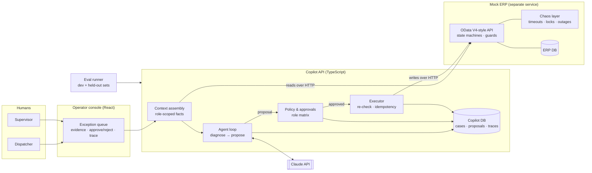

# Dispatch-Exception Copilot

**An AI copilot that works out why a cement shipment is stuck, proposes the fix, and lets a human approve it, without ever being able to make an unsafe change itself.**

> **Status (2026-10-03): building.** The spec is frozen, and the mock ERP works with tests passing. The copilot itself isn't built yet. This page is updated as the build progresses, and it says honestly what works and what doesn't. See [Status](#status).

---

## The problem

In bulk-material logistics, orders regularly get stuck between "the customer ordered" and "the truck left the gate". Credit is blocked, the books show less stock than the silo holds, the weighbridge reading doesn't match the plan, someone has the document open, or a goods-issue posting timed out and nobody knows whether it went through.

Each one is quick to fix *once you know which one it is*. Finding out means checking five screens, calling two people, and meanwhile a loaded truck waits at the gate.

## What this does

```
Diagnose  →  Propose  →  Human approves  →  Code executes
 (AI)         (AI)        (right role)       (re-checks everything first)
```

1. **Diagnose:** the copilot reads the order's real state from the ERP (stock, credit, weighments, locks, history) and names the problem.
2. **Propose:** it suggests exactly one fix from a fixed list, with the evidence behind it.
3. **Approve:** a dispatcher or supervisor approves or rejects it. Each role can only approve the actions it's allowed to.
4. **Execute:** ordinary code, not the AI, makes the change. It checks every condition again first, because things may have changed while the fix waited for approval.

**The AI is allowed to be wrong. The system is not allowed to do anything unsafe because of it.**

## What this repo sets out to prove

| Claim | How it will be shown |
|---|---|
| An AI agent can act on a system of record **safely** | The model can't call any write. Writes are typed, role-checked, re-validated and protected against duplicates in code. |
| We know **how often it's right** | An eval suite: a development set plus a held-out set written by an independent reviewer. It reports diagnosis accuracy, action accuracy and unsafe-action rate. **Unsafe-action rate must be 0, or the build fails.** |
| It survives a **hostile ERP** | The mock ERP injects failures on purpose: timeouts *after* a write has committed, lock conflicts, outages. |
| We know **what it costs** | Tokens, cost and time are tracked per case, with a strong model for diagnosis and a cheap one for simple steps. |

## Architecture



**Boundary rule:** the copilot reaches the ERP **only over HTTP**, never through its database, just as it would with a real system of record.

## v1 scope (until 2026-11-02)

- **Six diagnoses:** credit block, short stock, weighment out of tolerance, document locked, duplicate-goods-issue risk (a timeout after commit), and "not actually stuck".
- **Seven actions:** assign truck, adjust delivery quantity, post goods issue, reverse goods issue, request credit release, escalate, no action.
- **Two roles:** dispatcher and supervisor.
- **Three kinds of chaos:** timeout-after-commit, lock conflict, outage window.
- **Public demo:** replays recorded cases (no API spend); live mode sits behind a key.

**Not in scope:** real SAP systems, fine-tuning, multi-agent setups, agent frameworks, a generic chat UI.

All data is synthetic. **Kestrel Cement** is a fictional company.

## Decisions

*Written by the author as ADRs in [`docs/adr/`](docs/adr/). Summaries will appear here as they're written.*

## Status

| Area | State |
|---|---|
| Spec ([`docs/SPEC.md`](docs/SPEC.md)) | ✅ Frozen 2026-10-03 |
| Mock ERP ([`services/mock-erp`](services/mock-erp)) | ✅ v1 built: statuses and guards, OData-style reads and actions, chaos, 30 tests |
| Tools, PGI write tool | ⏳ Oct 5–11 |
| Agent loop, approvals, console | ⏳ Oct 12–18 |
| End-to-end v1 | ⏳ Target Oct 19 |
| Evals, telemetry, cost routing | ⏳ Oct 19–25 |
| AWS deploy, demo video | ⏳ Oct 26–Nov 1 |

## Repo layout

```
apps/console        React operator console
apps/api            copilot: context, agent loop, policy, executor, telemetry
services/mock-erp   the mock system of record (own process, own DB)
packages/contracts  shared types and validation
prompts/            versioned prompts
evals/              scenarios, runner, reports
docs/               spec, ADRs, runbook, failure analysis
```
